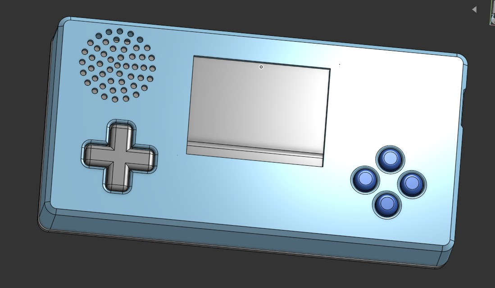
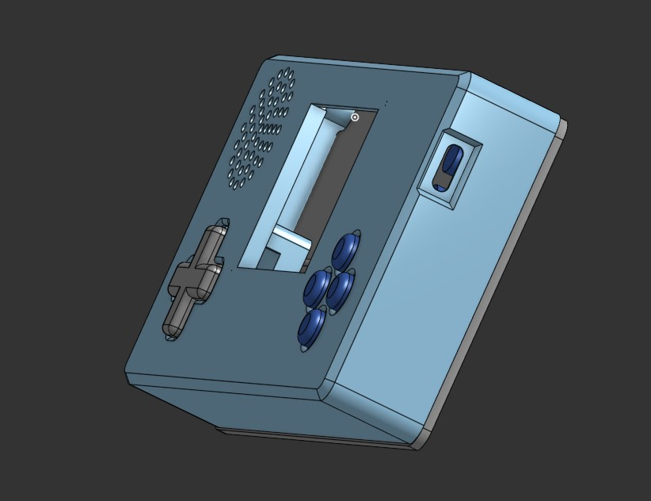
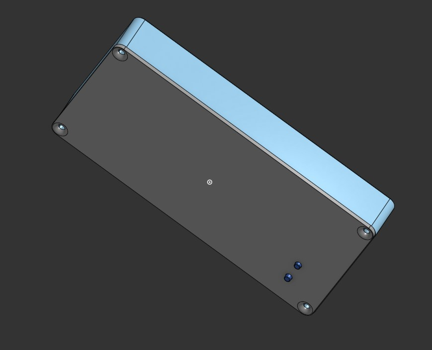
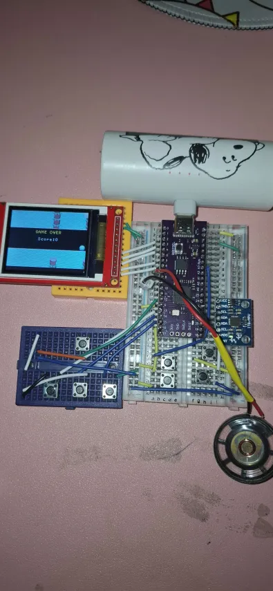
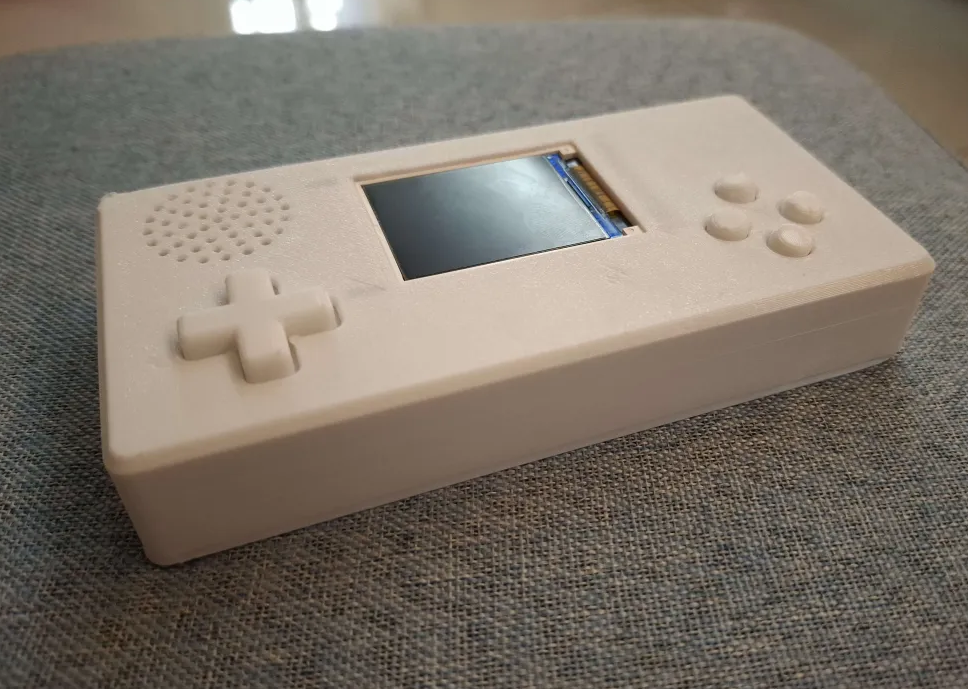
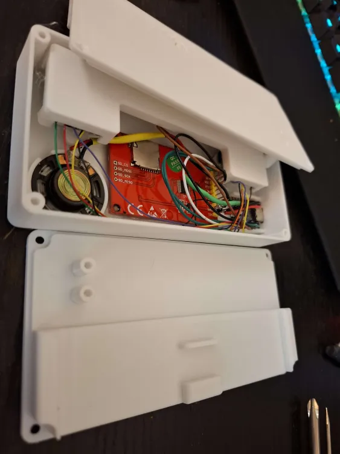
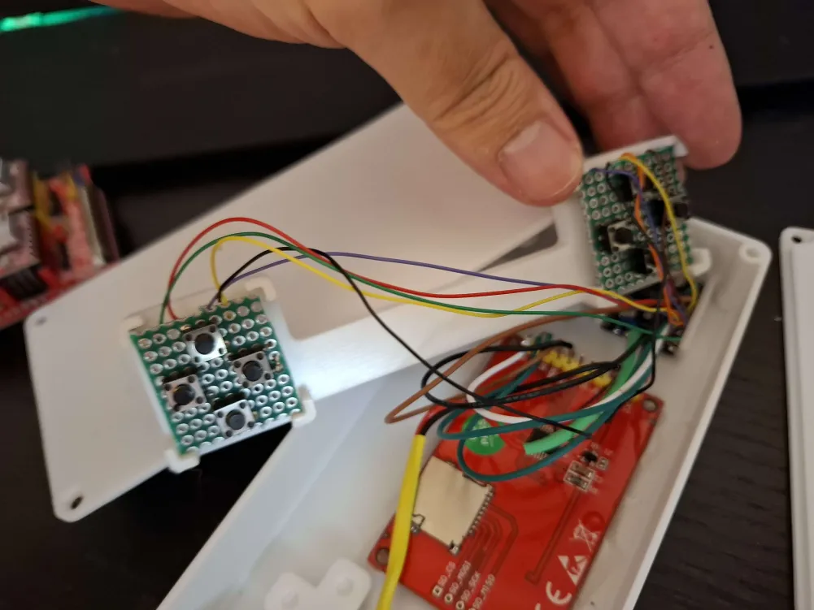

# 🎮 MakeCode Arcade RP2040 Game Console Project

If you’re dreaming of building your own retro-style handheld console without burning a hole in your wallet—congrats, you've stumbled upon the right micro-powered rabbit hole.

This little dynamo uses the RP2040Zero as its main MCU, which is basically the rock star of ultra-affordable microcontrollers these days. You can practically find them rolling around the bottom of your parts drawer. Got some spare components lying around? Perfect. You've got yourself a game console in the making.

What’s more, the finished device is fully compatible with MakeCode Arcade, meaning you (or your budding young game devs) can dive into game creation with ease. It's edutainment at its finest: one part electronics, one part programming, and a whole lot of fun.

🌟 Build it for yourself, build it for your kids, or build it because you're a grown-up kid who never got over their Game Boy. We don’t judge.

## 🧾 Bill of Materials (a.k.a. Things You’ll Need to Not Forget at the Electronics Store):

| Item	| Description |
| ---  | --- |
| 🖥 TFT | LCD	1.8” ST7735 Driver
| 🎮 Buttons |	8 push-buttons total
| 🔌 Breadboard |	One piece (not for toast)
| 🧵 Wires |	A handful of jumper wires
| 🔊 Speaker |	8W round speaker
| 💡 MCU |	RP2040Zero
| 🧪 AB Glue | 	Optional—depends on screen fit; screen tolerances may vary
| 🔩 Screws |	Four M3*8mm screws (for when stuff needs to stay stuck)

## 🛠 Pin Configuration:
```
# Display
PIN_DISPLAY_SCK = P_2
PIN_DISPLAY_MOSI = P_3
PIN_DISPLAY_DC = P_0
PIN_DISPLAY_RST = P_4
PIN_DISPLAY_CS = P_1

# Display Settings (adjust as needed)
DISPLAY_CFG0 = 0x80
DISPLAY_CFG1 = 0x603
DISPLAY_CFG2 = 0x16
DISPLAY_HEIGHT = 128
DISPLAY_WIDTH  = 160
DISPLAY_TYPE   = ST7735

# Buttons
PIN_BTN_A     = P_5
PIN_BTN_B     = P_6
PIN_BTN_MENU  = P_7
PIN_BTN_LEFT  = P_9
PIN_BTN_RIGHT = P_10
PIN_BTN_UP    = P_11
PIN_BTN_DOWN  = P_12

# Audio
PIN_JACK_SND  = P_13
```
## 3D Model




## Sketch version


## 🔗 Demo in Action:




## Firmware

[arcade-rp2040-pico.uf2](arcade-rp2040-pico.uf2)

## External link

DIY your own board:
[https://microsoft.github.io/uf2/patcher/](https://microsoft.github.io/uf2/patcher/)
